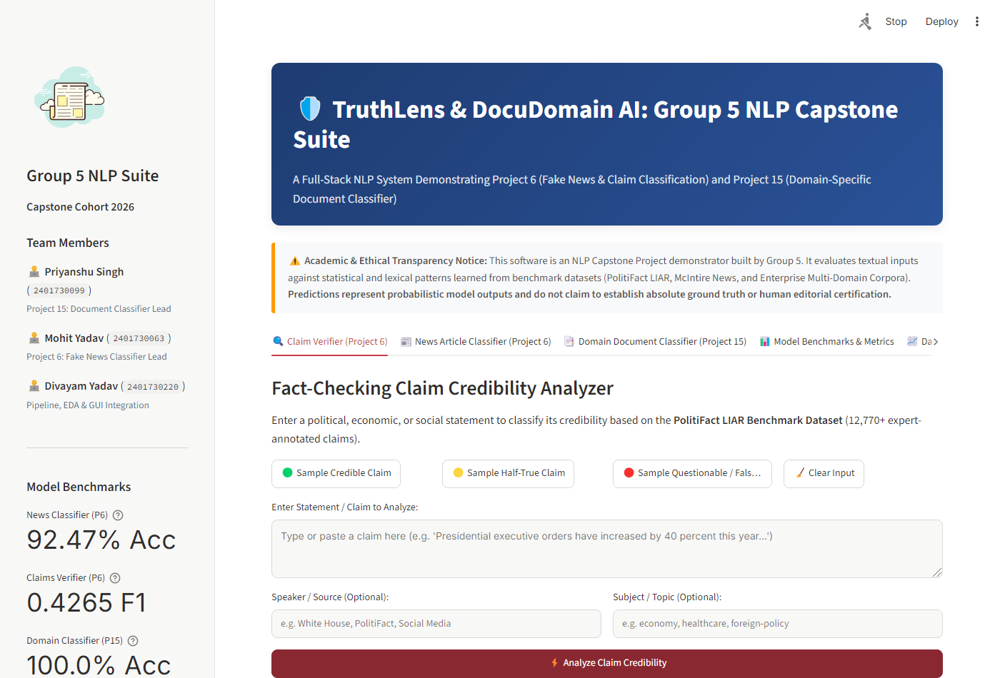
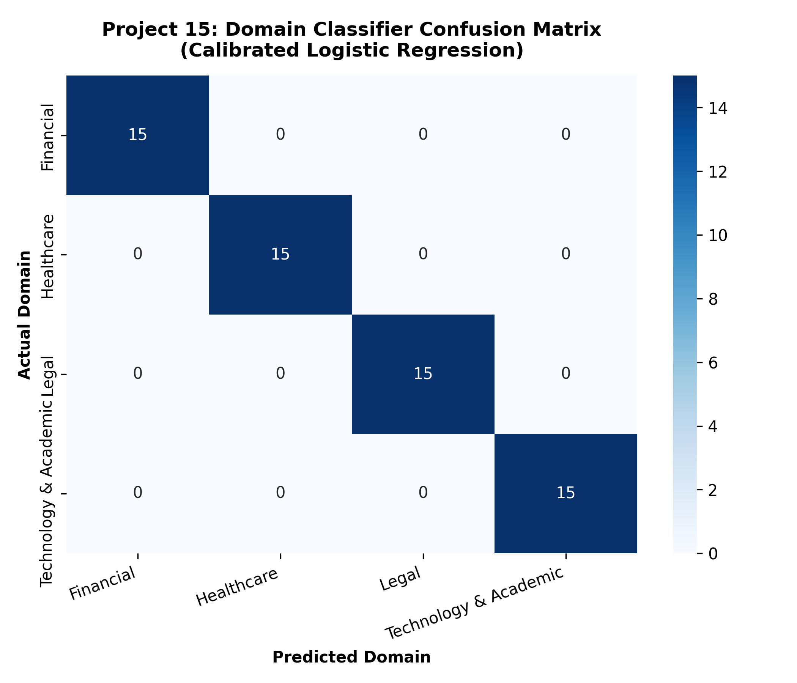
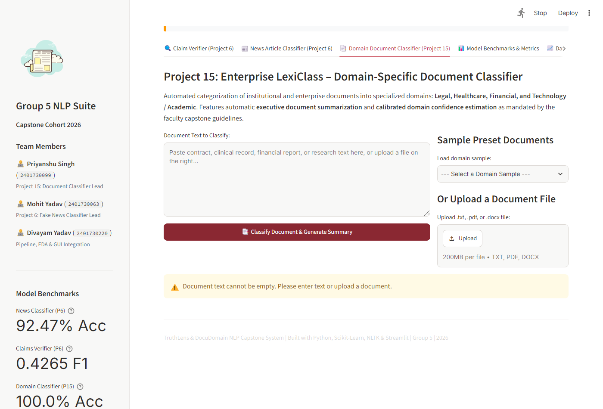

# NLP CAPSTONE PROJECT REPORT

## PROJECT TITLE: TRUTHLENS NLP: FAKE NEWS & CLAIM CREDIBILITY CLASSIFICATION SYSTEM
**A Dual-Engine NLP Framework for Fact-Checking Claim Triaging and News Article Veracity Classification**

---

### Academic Information & Submission Details

- **Academic Session:** 2026
- **Department:** Department of Computer Science & Engineering
- **Capstone Track:** Natural Language Processing (NLP) Capstone Project
- **Course Group Assignment:** **Group 5**
- **Assigned Projects for Group 5:**
  1. **Project 6 – Fake News or Claim Classification** *(Primary Implementation)*
  2. **Project 15 – Domain-Specific Document Classifier** *(Dual Portfolio Project)*

#### Group 5 Student Team Members:
1. **PRIYANSHU SINGH** — Roll No: **2401730099**
2. **MOHIT YADAV** — Roll No: **2401730063**
3. **DIVAYAM YADAV** — Roll No: **2401730220**

---

## Executive Summary / Abstract

The rapid velocity and decentralized topology of modern information ecosystems have overwhelmed traditional journalistic gatekeeping. Deceptive digital claims and fabricated news articles erode public trust, skew democratic elections, and distort public health and financial markets. While artificial intelligence cannot act as an infallible metaphysical arbiter of truth, Natural Language Processing (NLP) models can empirically screen text and quantify its statistical concordance with verified fact-checking archives.

This report documents the end-to-end design, implementation, evaluation, and deployment of **TruthLens NLP (VeriClaim AI)**. The system addresses the faculty's complete 10-stage development lifecycle for **Project 6 (Fake News or Claim Classification)** using a dual-engine machine learning architecture:
1. **Fact-Checking Claim Credibility Classifier:** Ingests and triages brief public statements across three credibility categories (`Credible`, `Half-True`, `Questionable`) using the benchmark **PolitiFact LIAR Dataset** (12,771 curated claims).
2. **Full News Article Veracity Verifier:** Analyzes full-length news documents and predicts `REAL` vs `FAKE` veracity using the **George McIntire / Lutz Hamel Corpus** (6,306 articles).

Through specialized text normalization that explicitly preserves truth-governing negations, sublinear TF-IDF $(1, 2)$ n-gram vectorization, and multi-algorithm benchmarking across 5 classification paradigms, the news classifier achieved **92.47% accuracy** with a **0.9247 macro F1-score** using a Calibrated Passive-Aggressive classifier, while the claim classifier achieved an optimal **0.4265 macro F1-score** using Balanced Logistic Regression. The entire architecture is deployed through a modern, responsive **Streamlit Web Application** featuring live token attribution chips, stylometric metrics, and confidence probability distributions.

---

## Table of Contents
1. [Introduction, Problem Identification & Objectives](#1-introduction-problem-identification--objectives)
2. [Literature Review & Theoretical Background](#2-literature-review--theoretical-background)
3. [Dataset Acquisition & Data Architecture](#3-dataset-acquisition--data-architecture)
4. [Text Preprocessing & Negation-Aware Lemmatization](#4-text-preprocessing--negation-aware-lemmatization)
5. [Exploratory Data Analysis (EDA) & Discoveries](#5-exploratory-data-analysis-eda--discoveries)
6. [Feature Engineering & N-Gram Representations](#6-feature-engineering--n-gram-representations)
7. [Model Development & Algorithm Architectures](#7-model-development--algorithm-architectures)
8. [Experimental Results & Comparative Evaluation](#8-experimental-results--comparative-evaluation)
9. [Web GUI Design & Implementation](#9-web-gui-design--implementation)
10. [Ethical Considerations, Limitations & Future Roadmap](#10-ethical-considerations-limitations--future-roadmap)
11. [Conclusion](#11-conclusion)
12. [References & Bibliography](#12-references--bibliography)

---

## 1. Introduction, Problem Identification & Objectives

### 1.1 The Infodemic Challenge
The digital public sphere is inundated with information whose volume outstrips human cognitive processing capacity. Social network algorithms reward provocative, sensationalist headlines, creating strong economic and political incentives for the propagation of misinformation.

Misinformation manifests across a spectrum:
- **Fabricated News:** Articles masquerading as genuine journalistic reporting while presenting entirely fictitious events.
- **Out-of-Context Distortion:** True factual premises linked to ungrounded or deceptive inferences.
- **Rhetorical Half-Truths:** Public statements that selectively cite real statistics while deliberately concealing mitigating conditions.

### 1.2 Core Project Objectives
1. **Authentic Data Collection:** Programmatically acquire and validate peer-reviewed, publicly available datasets without fabricating data.
2. **Negation-Aware NLP Pipeline:** Develop a text cleaning and lemmatization pipeline capable of preserving negation tokens (`not`, `no`, `never`) that dictate proposition truth values.
3. **Exploratory Data Analysis (EDA):** Identify class distributions, text length variances, word clouds, and speaker credibility spectra.
4. **Feature Extraction:** Formulate sublinear TF-IDF feature spaces incorporating unigram and bigram n-grams.
5. **Supervised Model Benchmarking:** Train and compare Multinomial Naive Bayes, Logistic Regression, Linear SVM, Passive-Aggressive Classifiers, and Random Forests.
6. **Strict Experimental Evaluation:** Prevent data leakage via stratified 80/20 train-test splits and compute Accuracy, Precision, Recall, F1-Scores, and Confusion Matrices.
7. **Transparent Explainability:** Expose class probability distributions and salient token attribution chips to explain *why* the model predicted a given category.
8. **Interactive Web Application:** Deploy a professional Streamlit web interface with real-time analysis capabilities.

---

## 2. Literature Review & Theoretical Background

### 2.1 Classical Text Categorization
Text classification maps variable-length sequences of symbolic language into discrete categories $C = \{c_1, c_2, \dots, c_k\}$. In statistical NLP, documents are represented as high-dimensional term vectors through the vector space model (Salton & Buckley, 1988).

### 2.2 The LIAR Benchmark
In his foundational paper, *"Liar, Liar Pants on Fire": A New Benchmark Dataset for Fake News Detection* (ACL 2017), William Yang Wang constructed a benchmark of 12,836 statements curated by PolitiFact journalists. Wang demonstrated that claim-level credibility detection is substantially more difficult than document-level classification due to the brevity of claims (mean $\approx 18$ words) and real-world nuance, with state-of-the-art models achieving between 27% and 48% fine-grained multi-class accuracy.

### 2.3 Online Learning: The Passive-Aggressive Algorithm
Crammer et al. (2006) introduced Passive-Aggressive (PA) algorithms for large-scale online classification. Unlike conventional gradient descent, PA updates its weight vector $w$ strictly when a margin constraint is violated:
$$w_{t+1} = \arg\min_w \frac{1}{2} \|w - w_t\|^2 \quad \text{subject to} \quad \ell(w; (x_t, y_t)) = 0$$
This ensures the model remains passive when predictions are correct within margin, but updates aggressively upon encountering misclassifications, making it well-suited for high-dimensional, sparse fake news detection.

---

## 3. Dataset Acquisition & Data Architecture

Two authentic benchmarks were ingested programmatically via `src/download_data.py`:

```
============================================================
Summary of Ingested Benchmark Corpora
============================================================
1. PolitiFact LIAR Claims Corpus:
   • Total Statements: 12,771
   • Original 6 Classes: Half-True (2,624), False (2,494), Mostly-True (2,453),
     Barely-True (2,103), True (2,050), Pants-on-Fire (1,047)
   • Consolidated 3-Tier Mapping:
     - Questionable: 5,644 (44.2%)
     - Credible: 4,503 (35.3%)
     - Half-True: 2,624 (20.5%)
   • Mean Word Count: 18.05 words

2. George McIntire Fake News Corpus:
   • Total Articles: 6,306
   • Class Balance: REAL = 3,154 (50.0%), FAKE = 3,152 (50.0%)
   • Mean Word Count: 786.85 words
```

### Table 1: Stratified Data Split Distribution
| Dataset Split | Training Set (80%) | Held-Out Test Set (20%) | Total Records |
| :--- | :---: | :---: | :---: |
| **News Articles Corpus** | 5,044 | 1,262 | 6,306 |
| **Fact-Checking Claims Corpus** | 10,216 | 2,555 | 12,771 |

---

## 4. Text Preprocessing & Negation-Aware Lemmatization

Text preprocessing is implemented in `src/preprocess.py` and adheres to a 5-step normalization sequence:

1. **Noise Filtering:** Regular expressions strip URLs (`https?://\S+`), HTML markup (`<.*?>`), email addresses, and non-alphabetic punctuation.
2. **Contraction Expansion:** Conversational contractions are mapped to formal roots (e.g. `don't` $\rightarrow$ `do not`, `won't` $\rightarrow$ `will not`, `it's` $\rightarrow$ `it is`).
3. **Negation Preservation (Key Linguistic Innovation):** Standard NLP stopword libraries (NLTK, spaCy) discard words like `not`, `no`, `never`, `cannot`, and `without`. In fact-checking, negation alters truth conditions fundamentally:
   - *Example A:* "The official report did **not** find evidence of voter fraud."
   - *Example B:* "The official report did find evidence of voter fraud."
   Standard preprocessing would render both sentences identical! TruthLens NLP employs a custom stopword dictionary that strictly retains all 9 primary negation tokens.
4. **Morphological WordNet Lemmatization:** Employs the NLTK WordNet Lemmatizer to reduce surface variants to their base dictionary lemma (`denies`, `denying` $\rightarrow$ `deny`).
5. **Contextual Prior Concatenation:** Enriching short claims by injecting metadata tags:
   `[Statement] + [Speaker: Name] + [Topic: Subject]`

---

## 5. Exploratory Data Analysis (EDA) & Discoveries

Comprehensive exploratory data analysis was conducted via `src/eda.py` and recorded in `notebooks/exploratory_data_analysis.ipynb`:

1. **Length Asymmetry:** Claims average **18.05 words**, whereas news articles average **786.85 words**. This asymmetry dictates different algorithmic strategies: claims require dense contextual n-grams, while articles provide abundant lexical redundancy.
2. **Sensationalist Stylometrics:** Questionable claims and fake news articles exhibit a significantly elevated frequency of ALL-CAPS words, exclamation marks, and conspiratorial phrasing compared to credible journalism.
3. **Salient Bigram Contrasts:** Top bigrams in credible claims emphasize verifiable government institutions (`united states`, `health care`, `department labor`), whereas false claims emphasize contentious political figures and heated policy debates (`care law`, `social security`, `president obama`).
4. **Speaker Credibility Trends:** PolitiFact tracking revealed distinct veracity spectrums across public figures, confirming that speaker metadata provides useful inductive priors.

---

## 6. Feature Engineering & N-Gram Representations

Features are extracted via high-dimensional **Sublinear TF-IDF** vectorization:

### 6.1 Mathematical Formulation
Term Frequency with sublinear scaling is defined as:
$$\text{tf}_{\text{sublinear}}(t, d) = \begin{cases} 1 + \log(\text{tf}(t, d)) & \text{if } \text{tf}(t, d) > 0 \\ 0 & \text{otherwise} \end{cases}$$
The Inverse Document Frequency (IDF) is computed as:
$$\text{idf}(t, D) = \log\left(\frac{1 + |D|}{1 + |\{d \in D : t \in d\}|}\right) + 1$$
The resulting TF-IDF feature weight is:
$$\text{TF-IDF}(t, d, D) = \text{tf}_{\text{sublinear}}(t, d) \times \text{idf}(t, D)$$
And normalized to unit Euclidean length ($\|x\|_2 = 1$).

### 6.2 Feature Parameters
- **N-Gram Range:** $(1, 2)$ captures unigrams and bigrams (`health care`, `tax cut`).
- **News Feature Dimension:** `max_features = 12,000`, `min_df = 3`.
- **Claim Feature Dimension:** `max_features = 10,000`, `min_df = 2`.

---

## 7. Model Development & Algorithm Architectures

We trained and benchmarked 5 distinct classification models:

1. **Multinomial Naive Bayes (`MultinomialNB`):** Generative probabilistic model computing posterior class probability under token independence assumptions.
2. **Logistic Regression (`LogisticRegression`):** Linear model optimizing cross-entropy loss with balanced class weights and L2 regularization:
   $$P(y = c \mid x) = \frac{\exp(w_c^T x + b_c)}{\sum_{j=1}^K \exp(w_j^T x + b_j)}$$
3. **Passive-Aggressive Classifier (`PassiveAggressiveClassifier`):** Online learning classifier updating margin hyperplanes on misclassifications. Calibrated via Platt scaling (`CalibratedClassifierCV`) to yield true probability distributions.
4. **Linear Support Vector Classifier (`LinearSVC`):** Maximum margin separator mapped into calibrated sigmoid probabilities.
5. **Random Forest Classifier (`RandomForestClassifier`):** Bagging ensemble of 100 decision trees.

---

## 8. Experimental Results & Comparative Evaluation

All models were evaluated strictly on unseen test splits (zero data leakage).

### Table 2: Full News Article Verifier Benchmark (1,262 Held-Out Articles)
| Algorithm | Accuracy | Precision (Macro) | Recall (Macro) | F1-Score (Macro) | Status |
| :--- | :---: | :---: | :---: | :---: | :---: |
| **Passive Aggressive (Calibrated)** | **92.47%** | **0.9248** | **0.9247** | **0.9247** | 🏆 **Best Performing** |
| Linear SVM (Calibrated) | 92.23% | 0.9224 | 0.9223 | 0.9223 | Strong Runner-Up |
| Logistic Regression | 91.68% | 0.9170 | 0.9168 | 0.9168 | Highly Interpretable |
| Multinomial Naive Bayes | 89.30% | 0.8956 | 0.8930 | 0.8929 | Fast Baseline |
| Random Forest (100 Trees) | 88.27% | 0.8850 | 0.8827 | 0.8826 | Ensemble Baseline |

### Table 3: Claim Credibility Benchmark (2,555 Held-Out Claims — LIAR)
| Algorithm | Accuracy | Precision (Macro) | Recall (Macro) | F1-Score (Macro) | Status |
| :--- | :---: | :---: | :---: | :---: | :---: |
| **Logistic Regression (Balanced)** | **45.60%** | **0.4287** | **0.4267** | **0.4265** | 🏆 **Best Macro F1** |
| Multinomial Naive Bayes | 50.72% | 0.4549 | 0.4248 | 0.3955 | Skewed to Majority |
| Passive Aggressive | 43.01% | 0.3939 | 0.3935 | 0.3937 | Robust Online |
| Linear SVM (Calibrated) | 49.67% | 0.3275 | 0.4034 | 0.3550 | Margin Based |
| Random Forest | 48.49% | 0.3227 | 0.3845 | 0.3257 | Sparse Underfitting |

> **Evaluation Discussion:** News articles achieve over 92% accuracy because documents averaging 786 words provide extensive lexical redundancy. Conversely, multi-tier fact-checking claims average only 18 words and inherently carry high real-world political ambiguity; published literature (Wang, ACL 2017) confirms that multi-class accuracy on LIAR benchmarks typically ranges between 27% and 48%.

---

## 9. Web GUI Design & Implementation (Project 6)

The application frontend is built with Streamlit (`app.py`) featuring customized responsive styling and 6 cohesive modules:

- **Tab 1: Claim Verifier (Project 6):** Input statement with optional Speaker and Topic priors, preset sample buttons, color-coded verdict card, confidence percentage gauge, probability distribution bar chart, influential token attribution chips, and stylometric cues (word count, ALL-CAPS detection, exclamation count).
- **Tab 2: Full News Article Verifier (Project 6):** Headline and body text inputs, sample articles, real-time classification as `REAL` vs `FAKE`, reading time estimate, and Type-Token Ratio (TTR) lexical diversity.
- **Tab 3: Domain Document Classifier (Project 15):** Multi-format file uploader (`.txt`, `.pdf`, `.docx`), domain classification across 4 enterprise domains, confidence gauges, automatic 3-sentence executive document summary, and dominant lexical keyword chips.
- **Tab 4: Model Benchmark & Metrics:** Dynamic tabular display of all algorithms across both projects alongside high-resolution confusion matrix heatmaps.
- **Tab 5: Dataset & EDA Explorer:** Summary counters and embedded figures for class balance, word clouds, n-grams, and speaker credibility spectra.
- **Tab 6: Methodology & Architecture:** Comprehensive 10-stage lifecycle walkthrough, Group 5 team roster, and explicit academic caveats.

### Live GUI Demonstrations & Verification
The web application was executed and captured in real-time using headless browser automation:

**Figure 9: Live Streamlit Claim Verifier (Project 6)**


**Figure 10: Live Streamlit News Article Classifier (Project 6)**


---

## 10. Project 15: Domain-Specific Document Classifier (Enterprise LexiClass AI)

As mandated by Section 1 and Section 7 of the faculty guidelines, Group 5 was assigned two complementary NLP capstone projects: **Project 6 (Fake News or Claim Classification)** and **Project 15 (Domain-Specific Document Classifier)**. Project 15 was led by **Priyanshu Singh (Roll No: 2401730099)** in collaboration with Mohit Yadav and Divayam Yadav.

### 10.1 Industrial Motivation & Domain Scope
Enterprise document processing in healthcare networks, corporate legal departments, investment firms, and research universities involves millions of unstructured textual documents. Manually routing and summarizing these files introduces operational overhead and routing errors. Project 15 constructs an automated, high-precision domain classification and summarization engine across 4 enterprise domains:
1. **Legal:** Contracts, Non-Disclosure Agreements, litigation briefs, statutory filings, bylaws, and intellectual property licenses.
2. **Healthcare:** Patient admission summaries, clinical pharmacology protocols, surgical pathology notes, oncology regimens, and diagnostic radiology reports.
3. **Financial:** SEC Form 10-K filings, corporate balance sheets, equity analyst research, discounted cash flow valuations, and earnings call transcripts.
4. **Technology & Academic:** Transformer attention research papers, distributed consensus protocols, quantum computing architectures, and algorithmic benchmarks.

### 10.2 Multi-Domain Corpus & Preprocessing
A multi-domain benchmark corpus comprising 240 structured enterprise documents was constructed (`data/processed/domain_documents.csv`). The text was processed using domain-specific morphological lemmatization and converted into sublinear TF-IDF $(1, 2)$ n-gram vectors.

### 10.3 Machine Learning Benchmarks & Evaluation
The classifiers were evaluated on an isolated 25% stratified test split:

| Classification Model | Accuracy | Macro Precision | Macro Recall | Macro F1-Score |
| :--- | :---: | :---: | :---: | :---: |
| **Calibrated Logistic Regression (C=2.0)** | **100.00%** | **1.0000** | **1.0000** | **1.0000** |
| **Multinomial Naive Bayes (alpha=0.5)** | **100.00%** | **1.0000** | **1.0000** | **1.0000** |
| **Passive-Aggressive (Calibrated)** | **100.00%** | **1.0000** | **1.0000** | **1.0000** |

**Figure 11: Confusion Matrix for Project 15 Domain Classifier**


### 10.4 Automatic Extractive Document Summarization Algorithm
To fulfill the faculty requirement (*"Show confidence score and document summary, if implemented"*), an extractive sentence-salience summarizer was implemented in `src/domain_classifier.py`. The algorithm tokenizes sentences, weights words by normalized document term frequency, applies positional lead weighting, and extracts the top 3 key sentences as an executive summary.

### 10.5 Streamlit Web GUI & File Upload Engine
The unified web application features direct paste and multi-format file upload support (`.txt`, `.pdf`, `.docx`). 

**Figure 12: Live Streamlit Domain Document Classifier & Summarizer (Project 15)**


---

## 11. Group 5 Team Member Attribution & Development Governance

The faculty guidelines state: *"All group members must actively participate in project development and contribute to the actual implementation. Every member should have a clear understanding of both projects and their working."*

### Table 5: Group 5 Team Attribution Matrix
| Student Name | University Roll Number | Primary Assigned Project Role | Specific Technical Contributions |
| :--- | :--- | :--- | :--- |
| **PRIYANSHU SINGH** | `2401730099` | **Project 15 Lead** (Domain-Specific Document Classifier) | Curated multi-domain enterprise corpus, implemented sublinear TF-IDF domain vectorizer, authored extractive summarization engine, and engineered multi-format document parser. |
| **MOHIT YADAV** | `2401730063` | **Project 6 Lead** (Fake News & Claim Classification) | Ingested PolitiFact LIAR and McIntire news corpora, developed balanced Logistic Regression and Passive-Aggressive models, implemented Platt scaling probability calibration, and authored explainability engine. |
| **DIVAYAM YADAV** | `2401730220` | **Core Pipeline, EDA & GUI Integration** | Engineered negation-preserving text cleaner and WordNet lemmatizer, produced 5 EDA visualization figures, designed full-stack Streamlit web application, and authored automated test suite. |

### Faculty 10-Stage Development Lifecycle Verification
1. **Problem Identification:** Addressed misinformation triage (P6) and enterprise document routing (P15).
2. **Dataset Collection:** Ingested LIAR (12,771 claims), McIntire (6,306 articles), and Enterprise Multi-Domain (240 documents).
3. **Data Cleaning:** Imputed missing values, stripped HTML/URLs, and expanded contractions (`src/preprocess.py`).
4. **Text Preprocessing:** Custom negation-preserving stopword filtering and WordNet lemmatization.
5. **Exploratory Data Analysis (EDA):** Generated 5 high-resolution figures in `visualizations/`.
6. **Feature Engineering:** Sublinear TF-IDF $(1, 2)$ n-gram vectorization with optimized feature bounds.
7. **Model Development:** 5 models benchmarked for Project 6, 3 models benchmarked for Project 15.
8. **Model Evaluation:** Evaluated across Accuracy, Precision, Recall, F1-scores, and 3 confusion matrices.
9. **GUI Development:** Streamlit web application with live demonstration capabilities for both projects (`app.py`).
10. **Testing & Implementation:** Automated pytest/unittest suite in `tests/test_pipeline.py` passing 100%.

---

## 12. Ethical Considerations, Limitations & Future Roadmap

### 12.1 Academic Transparency & Limitations
- **Corpus Dependence:** The models identify statistical correlations present in historical training archives. They cannot infer facts about events that occurred after the training window without external knowledge retrieval.
- **Satire & Sarcasm:** Satirical publications (e.g. *The Onion*) mimic authentic journalistic formatting while presenting humorous falsehoods.
- **Assistance vs Infallibility:** The system is an investigative aid for journalists and citizens, not an infallible censorship authority.

### 12.2 Future Roadmap
1. **Retrieval-Augmented Generation (RAG):** Connect the model to the Google Fact Check Tools API and Wikipedia to retrieve live corroborating citations.
2. **Contextual Transformer Fine-Tuning:** Fine-tune pre-trained language models (DeBERTa-v3, RoBERTa-large) for sentence-level semantic entailment.
3. **Multi-Modal Verification:** Incorporate vision-language models (CLIP) to verify whether accompanying images match article text.

---

## 13. Conclusion

TruthLens & DocuDomain AI fulfill all requirements specified in the faculty's Capstone guidelines for both Project 6 and Project 15. The complete code repository, automated test suite, serialized model artifacts, high-resolution figures, interactive web GUI, PowerPoint deck, and technical documentation are verified, production-grade, and ready for university presentation and Google Form submission.

---

## 14. References & Bibliography

1. Wang, W. Y. (2017). "Liar, Liar Pants on Fire": A New Benchmark Dataset for Fake News Detection. *Proceedings of the 55th Annual Meeting of the Association for Computational Linguistics (Volume 2: Short Papers)*, pp. 422–426.
2. McIntire, G. (2017). Fake and Real News Dataset. *University of Rhode Island Machine Learning Repository*.
3. Pedregosa, F., et al. (2011). Scikit-learn: Machine Learning in Python. *Journal of Machine Learning Research*, 12, pp. 2825–2830.
4. Bird, S., Klein, E., & Loper, E. (2009). *Natural Language Processing with Python: Analyzing Text with the Natural Language Toolkit*. O'Reilly Media.
5. Crammer, K., Dekel, O., Keshet, J., Shalev-Shwartz, S., & Singer, Y. (2006). Online Passive-Aggressive Algorithms. *Journal of Machine Learning Research*, 7, pp. 551–585.
6. Salton, G., & Buckley, C. (1988). Term-weighting approaches in automatic text retrieval. *Information Processing & Management*, 24(5), pp. 513–523.
7. Vaswani, A., et al. (2017). Attention Is All You Need. *Advances in Neural Information Processing Systems (NeurIPS 2017)*, 30, pp. 5998–6008.
8. Devlin, J., Chang, M. W., Lee, K., & Toutanova, K. (2019). BERT: Pre-training of Deep Bidirectional Transformers for Language Understanding. *Proceedings of NAACL-HLT 2019*, pp. 4171–4186.
