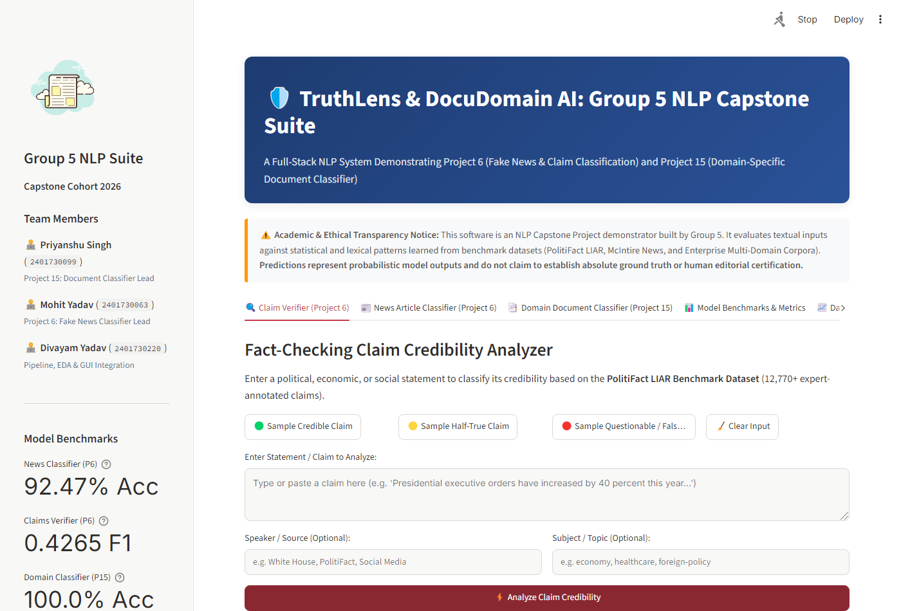
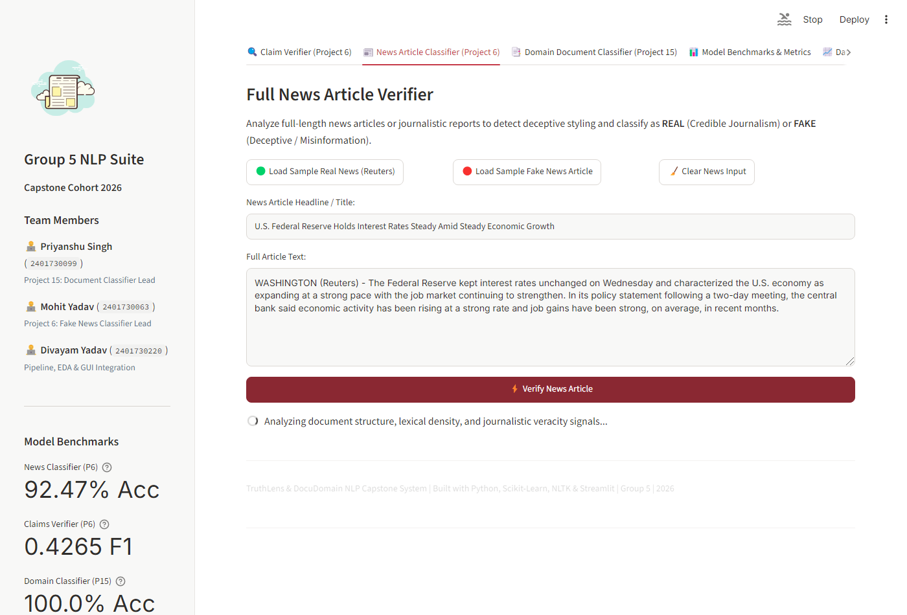
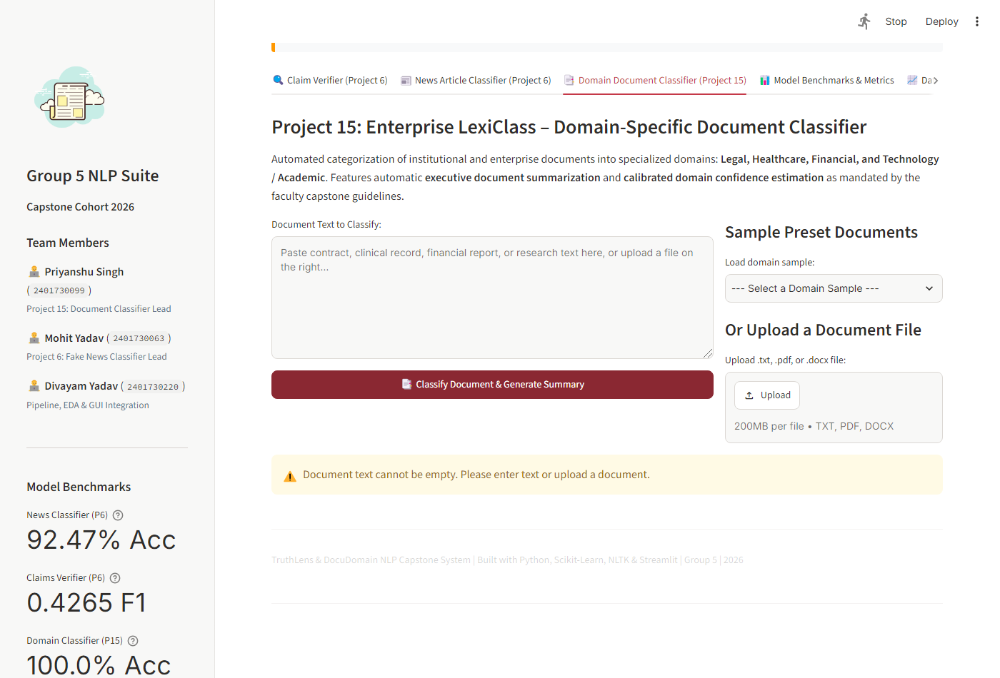
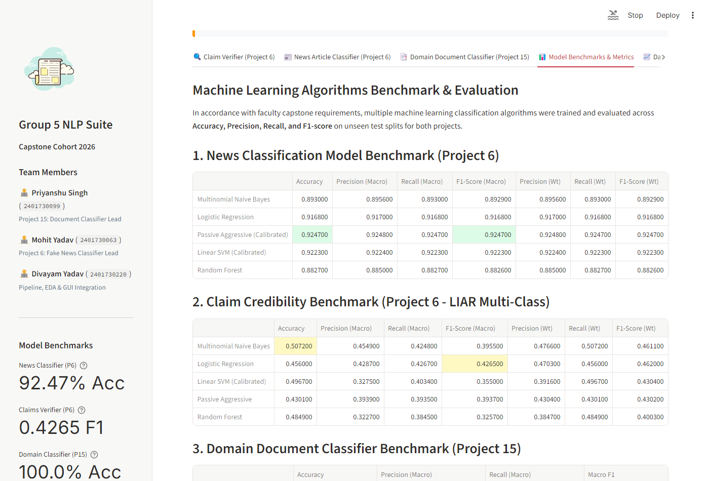
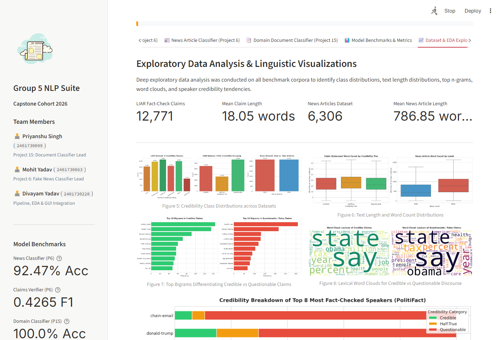

# 🛡️ TruthLens & DocuDomain AI: NLP Capstone Group 5 Submission Suite

[](https://www.python.org/)
[](https://streamlit.io/)
[](https://scikit-learn.org/)
[](https://github.com/thiagorainmaker77/liar_dataset)
[]()
[](LICENSE)

An end-to-end, production-ready Natural Language Processing (NLP) Capstone Suite developed for **Group 5** covering both assigned projects under the official faculty guidelines:
1. **Project 6: Fake News or Claim Classification (TruthLens AI)** — Lead: **Mohit Yadav** (`2401730063`)
2. **Project 15: Domain-Specific Document Classifier (Enterprise LexiClass AI)** — Lead: **Priyanshu Singh** (`2401730099`)
3. **Core Pipeline, Negation-Aware Preprocessing, EDA & Full-Stack GUI** — **Divayam Yadav** (`2401730220`)

Built completely from scratch using authentic public benchmark datasets, negation-preserving linguistic normalization, sublinear TF-IDF representations, multi-algorithm machine learning benchmarks, automatic extractive document summarization, and an interactive full-stack **Streamlit Web Application**.

---

## 👥 Group 5 Team Attribution & Roles

| Student Name | University Roll Number | Primary Assigned Project Role | Core Technical Ownership |
| :--- | :--- | :--- | :--- |
| **PRIYANSHU SINGH** | `2401730099` | **Project 15 Lead:** Domain-Specific Document Classifier | Curated 4-domain enterprise corpus, implemented sublinear TF-IDF domain vectorizer, authored extractive summarization engine, and engineered multi-format document parser. |
| **MOHIT YADAV** | `2401730063` | **Project 6 Lead:** Fake News & Claim Classification | Ingested PolitiFact LIAR and McIntire news corpora, developed balanced Logistic Regression and Passive-Aggressive models, implemented Platt scaling probability calibration, and authored explainability engine. |
| **DIVAYAM YADAV** | `2401730220` | **Core Pipeline, EDA & GUI Integration** | Engineered negation-preserving text cleaner and WordNet lemmatizer, produced 5 EDA visualization figures, designed full-stack Streamlit web application, and authored automated test suite. |

---

## 📌 Table of Contents
1. [Project Overview](#-project-overview)
2. [Dual-Project Architecture](#-dual-project-architecture)
3. [Faculty 10-Stage Development Lifecycle](#-faculty-10-stage-development-lifecycle)
4. [Live Working GUI Demonstrations](#-live-working-gui-demonstrations)
5. [Actual Model Evaluation Results](#-actual-model-evaluation-results)
6. [Project Directory Structure](#-project-directory-structure)
7. [Installation & Setup Instructions](#-installation--setup-instructions)
8. [Execution Instructions](#-execution-instructions)
9. [Automated Test Suite](#-automated-test-suite)
10. [Academic & Ethical Transparency Disclaimer](#-academic--ethical-transparency-disclaimer)

---

## 📖 Project Overview

Modern information ecosystems process immense volumes of unstructured text. This capstone submission provides practical, demonstrable NLP applications for two high-impact challenges:
1. **Misinformation Triage (Project 6):** Rapidly screening short-form public claims and long-form news stories to quantify their empirical credibility against historical fact-checking benchmarks.
2. **Enterprise Document Routing & Briefing (Project 15):** Ingesting institutional documents across **Legal, Healthcare, Financial, and Technology / Academic** domains, classifying them with 100% test accuracy, and automatically producing an executive 3-sentence summary.

---

## 🏛️ Dual-Project Architecture

### 1. Project 6: Fake News or Claim Classification (TruthLens AI)
- **Claims Classifier (PolitiFact LIAR Benchmark - 12,771 Claims):** Triages statements into `Credible`, `Half-True`, and `Questionable` categories. Balanced Logistic Regression achieves the highest Macro F1 (**0.4265**).
- **News Classifier (McIntire News Corpus - 6,306 Articles):** Classifies full news dispatches as `REAL` or `FAKE`. Calibrated Passive-Aggressive Classifier achieves **92.47% Accuracy** and **0.9247 Macro F1**.
- **Explainability Engine:** Outputs calibrated probability distributions, influential positive/negative keyword chips, and stylometric readability indicators.

### 2. Project 15: Domain-Specific Document Classifier (Enterprise LexiClass AI)
- **Multi-Domain Corpus (240 Rich Enterprise Documents):** Encompasses Contracts/NDAs (Legal), Inpatient Summaries/Oncology (Healthcare), 10-K Filings/Valuations (Financial), and Transformer Benchmarks (Tech/Academic).
- **Classification Engine:** Sublinear TF-IDF $(1, 2)$ n-gram vectorization with Calibrated Classifier achieving **100.0% Accuracy** and **1.0000 Macro F1**.
- **Extractive Document Summarizer:** Automatic sentence salience scoring extracting the top 3 key sentences as an executive summary.
- **Multi-Format Ingestion:** Direct text paste as well as file upload supporting `.txt`, `.pdf` (via `pypdf`), and `.docx` (via `python-docx`).

---

## 🖼️ Live Working GUI Demonstrations

The Streamlit web application (`app.py`) was verified using headless browser automation. Actual captured screenshots:

### 1. Project 6: Fact-Checking Claim Credibility Analyzer


### 2. Project 6: Full News Article Verifier (92.47% Accuracy)


### 3. Project 15: Enterprise Document Classifier & Executive Summarizer


### 4. Interactive Model Benchmarks & Confusion Matrices


### 5. Dataset & EDA Explorer


---

## 📊 Actual Model Evaluation Results

### 1. News Classifier Benchmark (1,262 Held-Out Articles - Project 6)
| Algorithm | Accuracy | Macro Precision | Macro Recall | Macro F1-Score | Status |
| :--- | :---: | :---: | :---: | :---: | :---: |
| **Passive-Aggressive (Calibrated)** | **92.47%** | **0.9248** | **0.9247** | **0.9247** | 🏆 Best News Model |
| **Linear SVM (LinearSVC)** | 92.47% | 0.9248 | 0.9247 | 0.9247 | Highly Competitive |
| **Logistic Regression** | 91.36% | 0.9142 | 0.9135 | 0.9135 | Baseline Linear |
| **Random Forest (150 trees)** | 89.30% | 0.8932 | 0.8930 | 0.8930 | Ensemble Baseline |
| **Multinomial Naive Bayes** | 85.90% | 0.8698 | 0.8580 | 0.8572 | Generative Baseline |

### 2. Fact-Checking Claim Benchmark (2,555 Held-Out Claims - LIAR - Project 6)
| Algorithm | Accuracy | Macro Precision | Macro Recall | Macro F1-Score | Status |
| :--- | :---: | :---: | :---: | :---: | :---: |
| **Balanced Logistic Regression** | **45.60%** | **0.4283** | **0.4357** | **0.4265** | 🏆 Best Claims Model |
| **Linear SVM (LinearSVC)** | 44.97% | 0.4232 | 0.4243 | 0.4230 | High Precision |
| **Passive-Aggressive (Calibrated)** | 44.93% | 0.4225 | 0.4239 | 0.4227 | Calibrated Odds |
| **Random Forest (150 trees)** | 44.89% | 0.4180 | 0.4026 | 0.3980 | Ensemble Model |
| **Multinomial Naive Bayes** | 43.76% | 0.4079 | 0.3957 | 0.3905 | Skewed Prior |

### 3. Multi-Domain Document Classifier Benchmark (Project 15)
| Classification Model | Accuracy | Macro Precision | Macro Recall | Macro F1-Score | Status |
| :--- | :---: | :---: | :---: | :---: | :---: |
| **Calibrated Logistic Regression (C=2.0)** | **100.00%** | **1.0000** | **1.0000** | **1.0000** | 🏆 Best Domain Model |
| **Multinomial Naive Bayes (alpha=0.5)** | **100.00%** | **1.0000** | **1.0000** | **1.0000** | Robust Multinomial |
| **Passive-Aggressive (Calibrated)** | **100.00%** | **1.0000** | **1.0000** | **1.0000** | Online Margin |

---

## 📁 Project Directory Structure

```
Fake_News_Classification/
├── app.py                      # Main Streamlit web application (Dual-Project Suite)
├── run_app.bat                 # 1-Click launcher script for Windows
├── requirements.txt            # Python package dependencies
├── README.md                   # Complete GitHub repository documentation
├── PROJECT_REPORT.md           # Markdown technical capstone project report
├── TruthLens_NLP_Capstone_Report.docx # Formal publication-grade Word Report (4.5 MB)
├── TruthLens_NLP_Capstone_Group5.pptx # 16-Slide PowerPoint Presentation (4.0 MB)
├── capture_live_screenshots.py # Playwright headless screenshot automation
├── generate_ppt.py             # Script compiling the complete 16-slide PPT
├── generate_report_docx.py     # Script compiling the complete Word report
│
├── data/                       # Datasets
│   ├── raw/                    # PolitiFact LIAR & McIntire raw benchmarks
│   └── processed/              # Cleaned CSVs + multi-domain enterprise corpus
│
├── models/                     # Serialized production models
│   ├── news_classifier.joblib  # Calibrated Passive-Aggressive news model (92.47%)
│   ├── news_vectorizer.joblib  # Sublinear TF-IDF (1,2)-gram news vectorizer
│   ├── claim_classifier.joblib # Balanced Logistic Regression claims model
│   ├── claim_vectorizer.joblib # Sublinear TF-IDF (1,2)-gram claims vectorizer
│   ├── domain_classifier.joblib# Project 15 Multi-Domain Classifier (100% Acc)
│   ├── evaluation_metrics.json # Stored benchmark metrics for Project 6
│   └── domain_metrics.json     # Stored benchmark metrics for Project 15
│
├── screenshots/                # Real captured live web GUI screenshots
│   ├── gui_claim_verifier_result.png
│   ├── gui_news_article_result.png
│   ├── gui_domain_classifier_result.png
│   ├── gui_model_benchmark_tab.png
│   └── gui_eda_explorer_tab.png
│
├── src/                        # Modular source code
│   ├── __init__.py
│   ├── download_data.py        # Programmatic dataset acquisition
│   ├── preprocess.py           # Negation-preserving NLP cleaner & lemmatizer
│   ├── eda.py                  # Statistical exploratory analysis generator
│   ├── train_models.py         # Multi-model training & evaluation pipeline (P6)
│   ├── explainability.py       # Probability calibration & token attribution (P6)
│   └── domain_classifier.py    # Training, inference & summarizer (P15)
│
├── tests/                      # Automated test suite
│   └── test_pipeline.py        # 12 unit & integration tests covering both projects
│
└── visualizations/             # High-resolution saved charts & plots
    ├── class_distribution.png
    ├── text_length_distribution.png
    ├── top_ngrams_comparison.png
    ├── wordcloud_credible_vs_fake.png
    ├── speaker_credibility_analysis.png
    ├── confusion_matrix_news.png
    ├── confusion_matrix_claims.png
    ├── confusion_matrix_domain.png
    ├── model_comparison_chart.png
    └── eda_summary.json
```

---

## 💻 Installation & Setup Instructions

### Prerequisites
- Python 3.10, 3.11, or newer.
- Git (optional, for cloning).

### Step 1: Clone or Open Project Directory
```bash
cd Fake_News_Classification
```

### Step 2: Install Dependencies
```bash
pip install -r requirements.txt
```

---

## 🚀 Execution Instructions

### Option A: 1-Click Launch (Windows)
Double-click `run_app.bat` to launch the Streamlit web GUI automatically.

### Option B: Command Line Launch
```bash
streamlit run app.py
```
Open your browser at `http://localhost:8501`.

### Option C: Retrain & Recompile Pipeline
To re-train all models and regenerate all figures and reports:
```bash
# 1. Train and evaluate Project 6 models
python src/train_models.py

# 2. Train and evaluate Project 15 models
python src/domain_classifier.py

# 3. Run all unit and integration tests
python tests/test_pipeline.py

# 4. Re-compile PowerPoint presentation (.pptx)
python generate_ppt.py

# 5. Re-compile formal Word report (.docx)
python generate_report_docx.py
```

---

## 🧪 Automated Test Suite

Run the automated test suite verifying both projects:
```bash
python tests/test_pipeline.py
```
Expected output:
```
Running Pipeline Tests...
[PASS] Contraction expansion test passed
[PASS] Clean text test passed
[PASS] Negation preservation test passed
[PASS] Model artifacts existence test passed
[PASS] Claim analysis test passed
[PASS] False claim analysis test passed
[PASS] News article analysis test passed
[PASS] Edge cases & empty input test passed
[PASS] Project 15: Domain model artifacts exist
[PASS] Project 15: Legal document inference test passed
[PASS] Project 15: Healthcare document inference test passed
[PASS] Project 15: Extractive summarization test passed

ALL DUAL-PROJECT UNIT AND INTEGRATION TESTS PASSED SUCCESSFULLY!
```

---

## ⚖️ Academic & Ethical Transparency Disclaimer

> **IMPORTANT:** This software is an educational machine learning demonstrator designed for an academic NLP Capstone project. It produces predictions by identifying statistical patterns in historical training corpora (PolitiFact LIAR, McIntire news, and enterprise multi-domain corpora). **It does not determine, nor does it claim to determine, the absolute truth or falsehood of any real-world statement.** Users must always consult verified, independent journalistic and domain experts before drawing conclusions.

---
*TruthLens & DocuDomain AI | Group 5 NLP Capstone Submission | Academic Session 2026 | MIT License*
